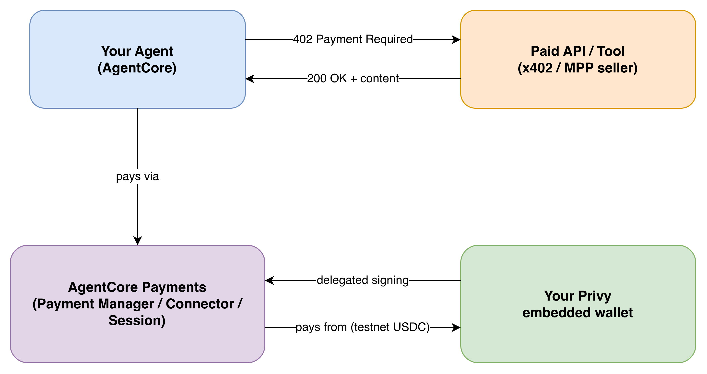

# Machine payments with Amazon Bedrock AgentCore and Stripe

Sample code for the joint AWS and Stripe machine payments workshop.

You deploy a content API on AWS Lambda and put an HTTP 402 paywall in front of it, using the
x402 protocol and Stripe machine payments. You then build an Amazon Bedrock AgentCore agent
that pays for that API on its own, from a Privy embedded wallet whose owner has delegated
signing rights to it. The agent runs on AgentCore Runtime and is driven from a chat panel in
the Privy wallet app, which shows each payment as it happens.

Payments settle in testnet USDC on Base Sepolia. No real money moves.



## Follow the workshop

The step-by-step instructions are in the workshop guide on AWS Workshop Studio:
[Machine Payments: Building with Amazon Bedrock AgentCore payments and Stripe](https://catalog.workshops.aws/).

This repository holds only the code. Follow the guide rather than running the code directly:
it covers the Stripe and Privy accounts you need and the order in which to configure them.

## Prerequisites

- An AWS account with access to Amazon Bedrock AgentCore in `us-east-1` or `us-west-2`
- A Stripe account with **Stablecoins and Crypto** activated in a sandbox. Stripe has to
  approve this request, so make it a few days before you start.
- A free Privy account
- Node.js 22, pnpm 9, Python 3.13, uv, the AWS CLI, the AWS CDK, and the
  `@aws/agentcore` CLI

## Repository layout

```
.
├── .env.example        Credential template for the whole workshop (copy to .env)
├── api/                Seller API: Lambda, API Gateway, and the x402 paywall (AWS CDK)
├── main/               One-off scripts that create the payment instrument and session
├── app/PaymentsAgent/  Buyer agent: Strands with the AgentCore payments plugin
├── agentcore/          AgentCore project configuration and its CDK app
├── privy-frontend/     Next.js wallet app for delegating signing and chatting with the agent
└── docs/               Architecture diagrams
```

## Security

This is sample code for learning. It is configured for testnets and Stripe sandboxes only.

- Never commit `.env` files. The `.gitignore` excludes them.
- `X402_FACILITATOR_URL` defaults to the public x402.org facilitator, which supports testnets
  only. Use an authenticated facilitator for live payments.
- Delete the resources you create when you finish. The workshop guide has a cleanup page.

See [CONTRIBUTING](CONTRIBUTING.md#security-issue-notifications) for how to report a
security issue.

## License

This library is licensed under the MIT-0 License. See the [LICENSE](LICENSE) file.

`privy-frontend/` is derived from
[privy-io/aws-agentcore-sdk](https://github.com/privy-io/aws-agentcore-sdk) and remains under
the Apache License 2.0. See [privy-frontend/LICENSE.md](privy-frontend/LICENSE.md) and
[THIRD-PARTY-LICENSES](THIRD-PARTY-LICENSES).
